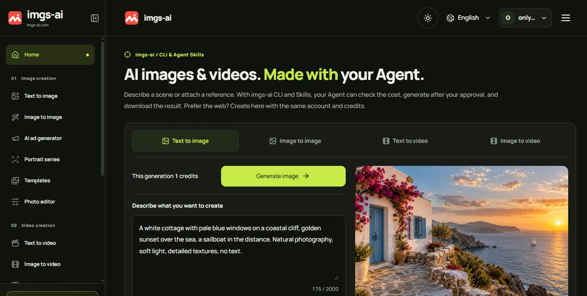
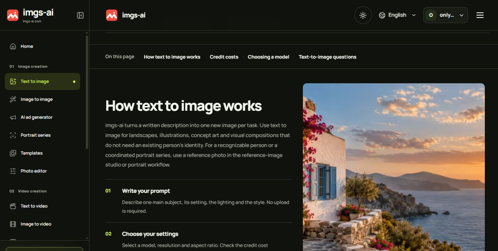
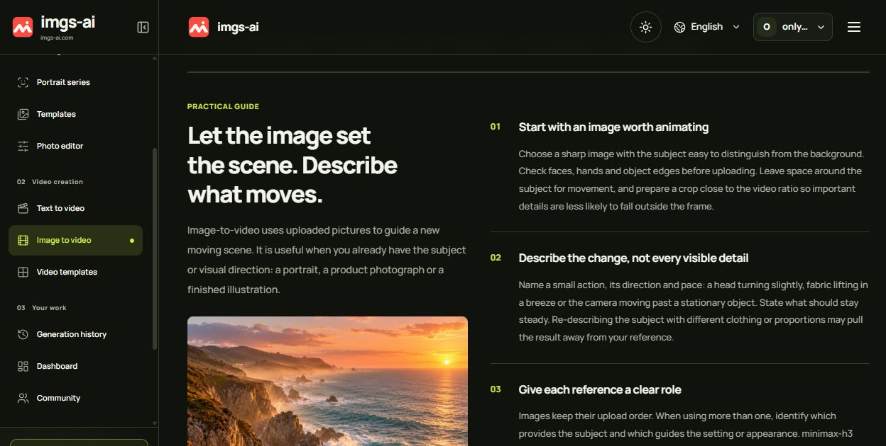
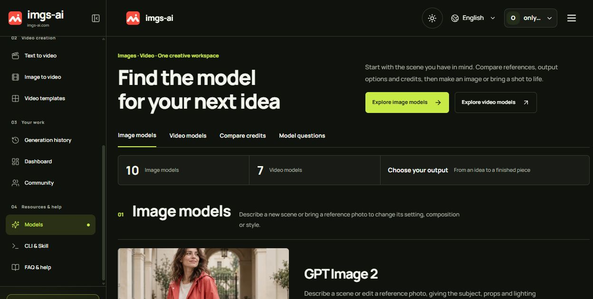
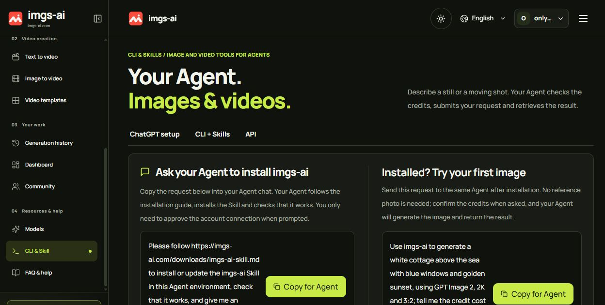

# imgs-ai

[Visit imgs-ai](https://imgs-ai.com/) · [Models](https://imgs-ai.com/models) · [Pricing](https://imgs-ai.com/pricing) · [CLI & Agent Skills](https://imgs-ai.com/cli)

Create AI images and short videos from prompts or reference media. Use the browser workspace, imgs-ai CLI, or Agent Skills with the same account and credit balance.

## What you can create

- **Text to image:** turn a written scene into an image; select the model, resolution and aspect ratio.
- **Image to image:** use reference pictures to guide an edit or a new composition.
- **Text to video and image to video:** describe a moving scene or animate reference imagery with model-specific settings.
- **Portrait series and ad workflows:** prepare connected portraits or product creative in dedicated workspaces.
- **CLI & Agent Skills:** let a compatible Agent check the credit quote, request your approval and retrieve the finished file.

Generation uses credits. Review the model settings and quote before submitting. A subscription is not required to buy a credit pack. AI output can vary; inspect each result before use. The site supports English, Simplified Chinese, Traditional Chinese, Spanish, Japanese and Korean.

## Website screenshots

Real screenshots captured on October 27, 2026. Example imagery illustrates the website and is not a benchmark of the selected model.

### Homepage workspace

### Text-to-image guide

### Image-to-video guide

### Model catalog

### CLI & Agent Skills

## Links

- [Official website](https://imgs-ai.com/)
- [Text to image](https://imgs-ai.com/text-to-image)
- [Image to image](https://imgs-ai.com/image-to-image)
- [Text to video](https://imgs-ai.com/text-to-video)
- [Image to video](https://imgs-ai.com/image-to-video)
- [Help](https://imgs-ai.com/faq)

This repository contains the imgs-ai product introduction and website screenshots. Website and CLI source code are not included.
